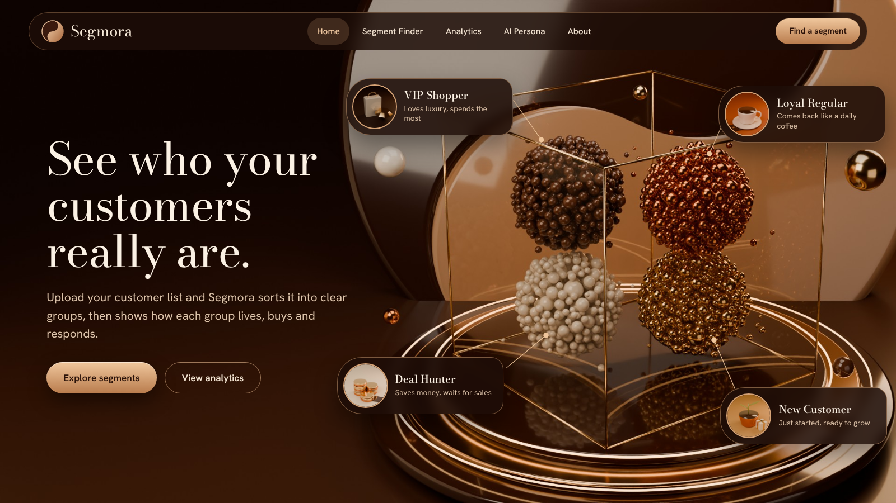
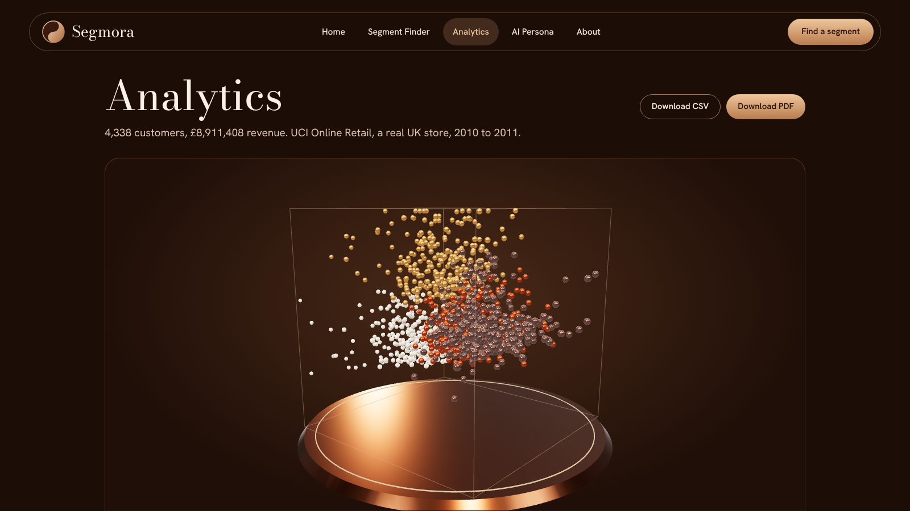
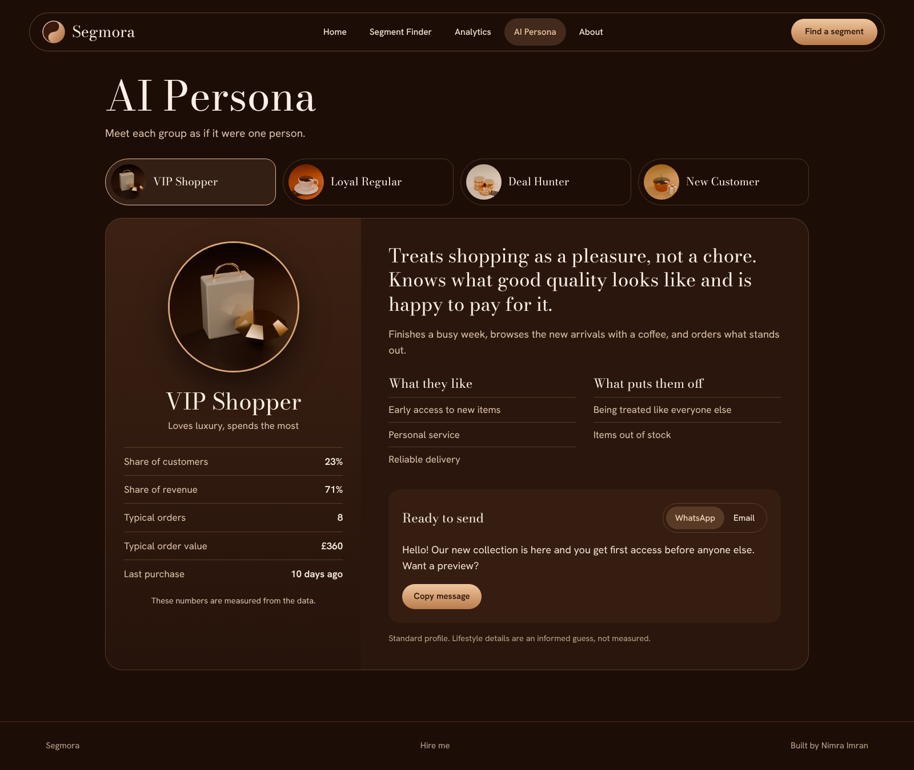
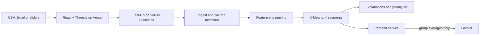

<p align="center"></p>

<h1 align="center">Segmora</h1>
<p align="center"><strong>See who your customers really are.</strong></p>
<p align="center">Customer segmentation with an interactive 3D view, plain-language explanations and a ready-to-use profile for every group.</p>
<p align="center"><a href="LIVE_URL">Live demo</a> &nbsp;&nbsp; <a href="LIVE_URL/api/docs">API docs</a></p>

---

## What it does

Upload a CSV or Excel file, or describe one customer. Segmora places each customer in one of four groups, says why, and tells you what to do next.

| Group | Behaviour in the data | Customers | Revenue |
|---|---|---:|---:|
| **VIP Shopper** | Recent, frequent, high total spend | 23% | 71% |
| **Loyal Regular** | Steady repeat buyer | 34% | 21% |
| **New Customer** | Recent first order, short history | 19% | 4% |
| **Deal Hunter** | One small order, long inactive | 25% | 3% |

## Features

- **Segment Finder:** live sliders for one customer, with match strength and the reasons behind the result
- **File upload:** CSV and Excel up to 4 MB and 20,000 customers, invoice lines or customer rows, automatic column recognition with manual matching as a fallback
- **Two modes:** use the trained model, or find four groups inside your own data
- **3D explorer:** real customers as beads, rotate, hover and focus on a group
- **Priority list:** who to contact first, why now, and the next step
- **AI personas:** lifestyle profile and ready WhatsApp and email messages; measured facts are kept separate from interpretation
- **Reports:** CSV and branded PDF

<table><tr><td></td><td></td></tr></table>

## Architecture



## The model

Data: [UCI Online Retail](https://doi.org/10.24432/C5BW33), 541,909 invoice lines reduced to 4,338 customers (see `backend/data/README.md`).

Features: recency, orders, total spend, tenure, product variety and average order value, log-transformed and standardised.

K-Means, Gaussian Mixture and Ward clustering were compared for 3 to 6 groups across silhouette, Davies-Bouldin and Calinski-Harabasz.

| Measure | Result |
|---|---|
| Final model | K-Means, 4 groups |
| Silhouette | 0.248 |
| Davies-Bouldin | 1.243 |
| Stability, adjusted Rand index over 20 refits on 80% of customers | 0.966 mean, 0.892 worst |

**Honest limits**

- Three groups score slightly higher (silhouette 0.296). Four were chosen because they map to clearer business actions.
- Silhouette near 0.25 means groups overlap, which is normal for customer behaviour.
- The data comes from one UK store in 2010 to 2011.
- The source has no discount field, so Deal Hunter is inferred from low order value and long inactivity.
- Persona lifestyle text is interpretation, and is labelled that way in the product.

## Privacy

Uploaded files are read once and never saved: the API keeps no customer data between requests. Only recognised columns are kept, so names, emails and phone numbers are dropped on read. The LLM receives group averages, never a customer row.

## API

| Method | Path | Purpose |
|---|---|---|
| `POST` | `/api/predict` | Segment one customer, with reasons and 3D position |
| `POST` | `/api/analyze` | Segment a CSV or Excel file |
| `GET` | `/api/analysis` | Demo store: segments, 3D points and priority list |
| `POST` | `/api/personas` | Write a group persona from its averages |
| `POST` | `/api/report.pdf` | Build the PDF report |
| `POST` | `/api/contact` | Send a contact message to the owner's Gmail |
| `GET` | `/api/model` | Model card |
| `GET` | `/api/health` | Health check |

## Configuration

Set these in Vercel under Settings, Environment Variables:

| Name | Purpose |
|---|---|
| `GEMINI_API_KEY` | Writes personas with Gemini. Without it, standard profiles are shown and labelled. |
| `GMAIL_USER` | Gmail address that receives contact messages |
| `GMAIL_APP_PASSWORD` | 16-character Google App Password |

## Run locally

```bash
# Backend
cd backend
python -m venv .venv && source .venv/bin/activate
pip install -r requirements-dev.txt
cp .env.example .env   # add GEMINI_API_KEY and Gmail settings
uvicorn app.main:app --reload

# Frontend
cd frontend
npm ci
npm run dev   # /api is proxied to localhost:8000

# Tests
cd backend && pytest -q
cd frontend && npm test
```

Rebuild the model with `python scripts/build_dataset.py <raw.csv>` then `python scripts/train.py`.

## Stack

FastAPI, NumPy, pandas, scikit-learn (offline model comparison), ReportLab, Gemini, React 19, TypeScript, Vite, Three.js, React Three Fiber, Blender (hero and persona artwork), GitHub Actions.

---

<p align="center">Built by <strong>Nimra Imran</strong>, AI Engineer</p>
